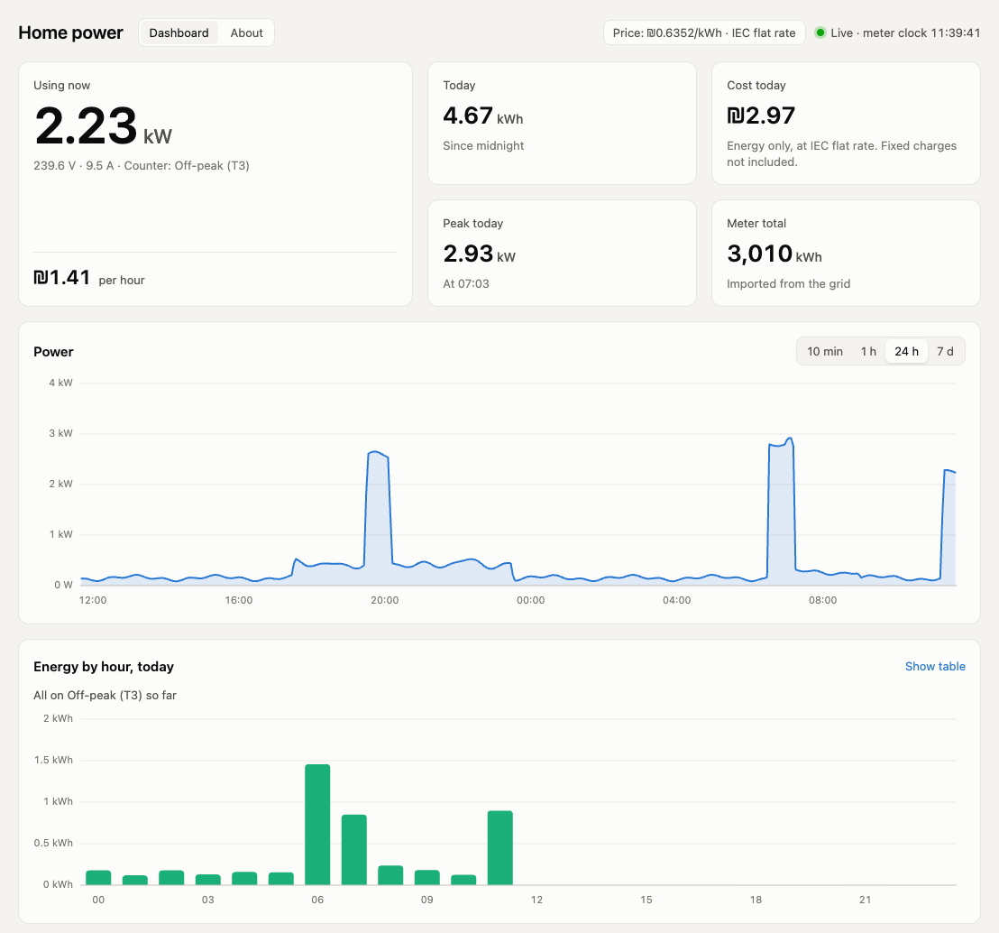
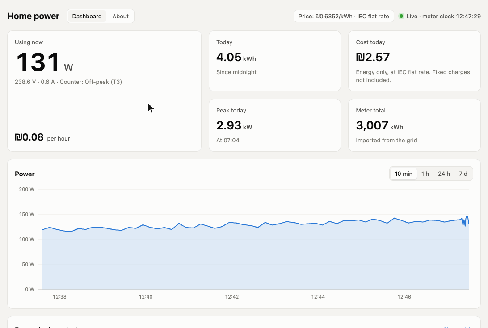

# IEC Kaifa P1 dashboard

A local, live electricity dashboard for Israel Electric Corporation (IEC) **Kaifa** smart meters, read through the **P1 port** (DSMR 5.0) with a USB cable.

<picture>
  <source media="(prefers-color-scheme: dark)" srcset="docs/dashboard-dark.png">
  
</picture>

<sub>Screenshot with demo data.</sub>

<details>
<summary><b>See it running</b> (animated, 4.7 MB)</summary>



<sub>Demo data and a simulated meter.</sub>
</details>

- Live power, voltage and current, updated every second
- Today's kWh, cost and peak
- Power chart (10 min / 1 h / 24 h / 7 d)
- Hourly energy split by tariff counter
- IEC flat and time-of-use prices
- A comparison of private supplier plans against your own usage
- A meter details page with every register and the raw telegram

Python standard library only: no packages to install, no cloud, and data stays on your machine.

## Status

| | |
|---|---|
| **Kaifa MA110M** (single-phase) on **macOS** | Built and used on a real meter |
| **Kaifa MA309M** (3-phase) | Same telegram codes; per-phase values are covered by tests with a synthetic telegram, not yet run on a real meter |
| **Linux** (e.g. Raspberry Pi) | Cable detection covered by tests, not yet run on real hardware |
| **Tariff counter labels** | T1 = peak and T3 = off-peak is inferred from IEC's time-of-use schedule and still unconfirmed ([`METER.md`](METER.md) §8) |

Reports from other meters and systems are welcome as issues.

## Requirements

- **Meter:** an IEC Kaifa MA110M or MA309M. The P1 port is the RJ12 socket behind the unsealed flap, and it must be active (it was on the meter this was built on).
- **Cable:** a P1 USB cable (FTDI FT232RL, RJ12, inverted serial, sold as a "Dutch smart meter P1 cable"). A plain USB-serial adapter won't work, because the P1 signal is inverted. macOS and Linux include the driver.
- **Computer:** macOS or Linux with **Python 3.9+** (tested on 3.9 and 3.14). Windows is not supported: the serial code uses `termios`.

The port sends **115200 8N1, inverted**, one telegram per second, with Israeli tariff codes `1-0:1.8.11 / .12 / .13`. See [`METER.md`](METER.md) §3–4.

## Quick start

```sh
git clone https://github.com/RoniRachmani/iec-kaifa-p1-dashboard.git
cd iec-kaifa-p1-dashboard
python3 server.py
```

Then open http://127.0.0.1:8765 in a browser.

The server finds the cable automatically: `/dev/cu.usbserial*` on macOS, and `/dev/serial/by-id/*FTDI*` or `/dev/ttyUSB*` on Linux. It picks only FTDI devices (USB vendor `0403`) and skips other USB-serial chips, such as a CH340 ESP32 board, with a note in the log. Use `--port` to read one of those anyway.

| Option | Default | |
|---|---|---|
| `--port` | auto-detect | Serial device |
| `--host` | `127.0.0.1` | `0.0.0.0` to open it from a phone on your Wi-Fi network. See [Security](#security) |
| `--allow-host` | — | Extra name the dashboard may be opened as, e.g. a DNS name for a Raspberry Pi. IP addresses, `localhost` and this computer's name are always allowed. Repeatable |
| `--http` | `8765` | Web port |
| `--db` | `data/p1.sqlite` | SQLite log, one row per 10 s |
| `--adopt-meter` | — | Give the log to the next meter seen, e.g. after IEC replaces yours. See [One log per meter](#one-log-per-meter) |

Unplugging the cable is fine: the server keeps serving and resumes within about 2 s of the cable returning.

### One log per meter

Each log belongs to one meter, identified by the equipment ID it sends (`0-0:96.1.1`). The first meter the server sees claims an empty log. If you plug the cable into a different meter, say in another flat, the dashboard still shows it live but saves nothing, and a banner says which meter the log belongs to. To log the other meter, give it its own file:

```bash
python3 server.py --db data/other-flat.sqlite
```

A log from before this check existed is claimed by the first meter whose counters carry on from its last row. If IEC replaces your meter, start once with `--adopt-meter` to move the log over to the new one.

**Linux:** your user needs access to the serial device. Run `sudo usermod -aG dialout $USER`, then log out and back in. The server logs a hint if it gets "permission denied".

**3-phase meters:** the dashboard shows voltage and current per phase (L1 / L2 / L3). The SQLite log keeps L1 voltage and current; energy, power and cost cover all phases.

## Run in the background

### macOS (at login)

```sh
REPO="$PWD"; PY="$(command -v python3)"
sed -e "s#__PYTHON__#$PY#g" -e "s#__REPO__#$REPO#g" -e "s#__HOME__#$HOME#g" \
    launchd/local.iec-kaifa-p1-dashboard.plist > ~/Library/LaunchAgents/local.iec-kaifa-p1-dashboard.plist
launchctl bootstrap gui/$(id -u) ~/Library/LaunchAgents/local.iec-kaifa-p1-dashboard.plist
```

If the project is in `~/Documents`, `~/Desktop` or `~/Downloads`, macOS may ask to let Python access that folder. Until you allow it, the server can't read its files; check the log if the page doesn't load.

| Task | Command |
|---|---|
| Restart after code changes | `launchctl kickstart -k gui/$(id -u)/local.iec-kaifa-p1-dashboard` |
| Stop | `launchctl bootout gui/$(id -u)/local.iec-kaifa-p1-dashboard` |
| Log | `~/Library/Logs/iec-kaifa-p1-dashboard.log` |

Logging pauses while the Mac sleeps. See [`ESP32-READER.md`](ESP32-READER.md) for an always-on reader.

### Linux (at boot, systemd)

```sh
mkdir -p ~/.config/systemd/user
cat > ~/.config/systemd/user/iec-kaifa-p1-dashboard.service <<EOF
[Unit]
Description=IEC Kaifa P1 dashboard

[Service]
ExecStart=$(command -v python3) -I $PWD/server.py
WorkingDirectory=$PWD
Restart=always
RestartSec=10

[Install]
WantedBy=default.target
EOF
systemctl --user enable --now iec-kaifa-p1-dashboard
sudo loginctl enable-linger $USER   # start at boot, not only after you log in
```

The log is in `journalctl --user -u iec-kaifa-p1-dashboard`.

## Security

- **There is no password.** By default the server only listens on `127.0.0.1`, so only this computer can reach it.
- **On your network** (`--host 0.0.0.0`), anyone on that network can see your usage, which shows when you're home, and can change prices. Use it only on a network you trust.
- **Other websites can't use it.** The server only answers requests addressed to this machine (an IP address, `localhost`, its own name or an `--allow-host` name), which blocks DNS-rebinding pages. Price changes must be JSON from the dashboard's own origin, so pages open in your browser can't change them.

To report a vulnerability, use GitHub's [private vulnerability reporting](https://github.com/RoniRachmani/iec-kaifa-p1-dashboard/security/advisories/new) rather than a public issue.

## Prices and plans

- **Prices:** set per tariff counter with the **Price** button. They are saved to `config.json`. The button offers presets for the IEC flat rate and this season's IEC time-of-use prices.
- **Cost covers electricity used only.** IEC's fixed monthly charge and the capacity charge are not included.
- **Supplier plans:** the comparison card reads [`plans.json`](plans.json). Edit it when offers change; no restart needed.
- **Dates:** IEC prices are from 1 July 2026 and supplier plans from 15 July 2026. Check current rates.

## API

| Endpoint | Returns |
|---|---|
| `GET /api/stream` | Server-Sent Events, one parsed telegram per second |
| `GET /api/recent` | Last 15 min, plus the latest reading. 1-second points from memory; after a restart the earlier part comes from the 10-second log, flagged as averages |
| `GET /api/history?seconds=N` | Bucketed average and peak power, for 10 min to 31 days |
| `GET /api/hourly?date=YYYY-MM-DD` | kWh per local hour per tariff counter (23- and 25-hour days handled) |
| `GET /api/plans?days=N` | Supplier plan savings projected from logged usage, for 1–366 days |
| `GET /api/meta` | Raw telegram, age of the last reading, link and error counts, logger stats (including the log's meter ID and any other meter connected) |
| `GET` / `POST /api/config` | Prices and currency. `POST` needs `Content-Type: application/json` |

Bad parameters return `400`.

## Files

| Path | |
|---|---|
| `server.py` | Serial reader, CRC check, SQLite logger with hourly summary, web server |
| `index.html` | Dashboard |
| `about.html` | Meter details page |
| `plans.json` | Supplier offers for the plan comparison |
| `launchd/` | macOS login-item template |
| `tests/` | Unit tests (stdlib `unittest`) and a masked sample telegram |
| [`METER.md`](METER.md) | Everything known about the meter, the P1 port, IEC tariffs and official documentation |
| [`ESP32-READER.md`](ESP32-READER.md) | Parts, wiring and plan for a standalone ESP32 P1 reader |
| [`ESP32-BOARD.md`](ESP32-BOARD.md) | The ESP32 board on hand: hardware, chip, eFuses, flash layout, firmware and backup |
| `docs/` | README screenshots and animated demo (demo data) |
| `reference/` | Datasheets, standards, certificates, tariffs, a redacted meter photo and an ESP32 board photo |
| `data/`, `config.json` | Your usage log and prices. Created at runtime and **git-ignored** |

## Tests

```sh
python3 -m unittest discover -s tests
```

## Licence

MIT. See [`LICENSE`](LICENSE). Documents in `reference/` belong to their publishers.

## Disclaimer

Not affiliated with IEC or Kaifa. The P1 port is read-only and opto-isolated: only open the unsealed P1 flap, never the sealed covers.
